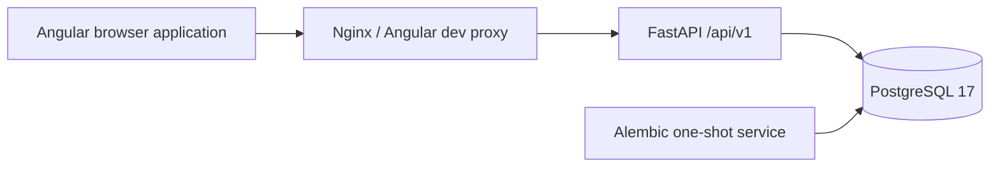

# Foundation architecture

The application is a modular monolith. Only foundation concerns exist in Phase 0. Business modules will be created as approved phases need them.

`apps/api/app/main.py` composes the application and owns startup/shutdown. `core/` owns configuration, JSON logs, and error handling. `api/` owns HTTP contracts. `db/` owns SQLAlchemy metadata, async connection pools, and session lifecycles. Migrations are separate explicit operations. No connection is opened at module import time, and no schema is created by application startup.

The browser uses a relative `/api/v1` path. Nginx forwards it in containers; the Angular development proxy forwards it during host development. The frontend build therefore contains no deployment hostname or credentials. CORS is unnecessary for the supported same-origin route.

PostgreSQL is authoritative. Phase 0 has no application tables. The sole migration establishes Alembic revision `0001_foundation`. Readiness verifies both connectivity and the deployed migration head, so an unmigrated database cannot appear ready.

The API remains live during database outages. Connection acquisition and readiness have bounded deadlines. Pool pre-ping detects dead connections; shutdown disposes the pool. Each future request session receives its own async SQLAlchemy session; future services must own transaction boundaries explicitly.

The foundation page has loading, connected, and unavailable states plus a user-triggered retry. No scheduled polling, business dashboard, accounts, scanning, AI, or matching is present.

Future boundaries from the master plan remain identity/users/RBAC, preferences, companies, discovery, extraction, normalization/jobs, matching, integrations, and orchestration. Redis/Celery and Python Playwright belong to their later phases, not this runtime.
