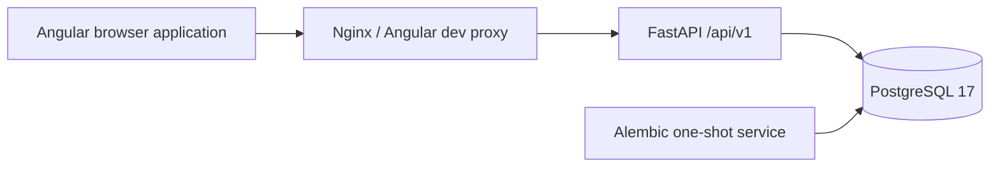

# Foundation architecture

The application is a modular monolith. Phase 1 added identity, users/profiles, and authorization; Phase 2 adds private companies and preference profiles. Further modules are created only as approved phases need them.

`apps/api/app/main.py` composes the application and owns startup/shutdown. `core/` owns configuration, JSON logs, and error handling. `api/` owns HTTP contracts. `db/` owns SQLAlchemy metadata, async connection pools, and session lifecycles. Migrations are separate explicit operations. No connection is opened at module import time, and no schema is created by application startup.

The browser uses a relative `/api/v1` path. Nginx forwards it in containers; the Angular development proxy forwards it during host development. The frontend build therefore contains no deployment hostname or credentials. CORS is unnecessary for the supported same-origin route.

PostgreSQL is authoritative. Revision `0003_companies_preferences` follows the identity revision and adds two owner-scoped tables and eight permission contracts. Readiness verifies both connectivity and the deployed migration head, so an unmigrated database cannot appear ready. JWT identity, live session state, effective database permissions, and owner-scoped queries protect operations; see [ADR 0002](../decisions/0002-authentication-sessions-rbac.md) and [ADR 0003](../decisions/0003-companies-preferences.md).

The API remains live during database outages. Connection acquisition and readiness have bounded deadlines. Pool pre-ping detects dead connections; shutdown disposes the pool. Each future request session receives its own async SQLAlchemy session; future services must own transaction boundaries explicitly.

The foundation page retains loading, connected, and unavailable states plus retry. Account routes provide registration, login, profile editing, and sessions. Company/preference list and editor routes use the same guards, permissions, CSRF handling, and refresh flow. HttpOnly cookies hold credentials; public account data stays in memory. Company URLs are input-validated without DNS or HTTP; typed preference documents persist in JSONB without executing matching. No scheduled polling, discovery, scanning, AI, or matching is present.

Future boundaries are discovery, extraction, normalization/jobs, matching, integrations, and orchestration. Redis/Celery and Python Playwright belong to their later phases, not this runtime. Future network access must independently validate DNS, redirects, and actual connection destinations; a stored company URL is not an SSRF-safe authorization token.
