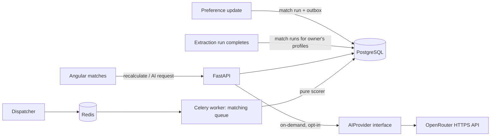

# Phase 5 implementation plan: matching engine and AI integration

Status: approved by the user with the four recommended decisions in section 4; implementation in progress.

## 1. Starting evidence and gap assessment

Phase 4 is committed at `3510781` and verified locally:
- 201 backend tests, 42 Angular tests, and 13 Playwright journeys pass;
- migration, container, audit, and secret gates pass.

Hosted GitHub Actions passed for Phase 4 at `9d8a817` ([run 38646275133](https://github.com/azeez148/career-intelligence-platform/actions/runs/38646275133)).

What matching can build on:

- **Preference profiles (Phase 2).** Each is a typed criteria document containing:
  - preferred and required skills;
  - preferred and excluded keywords;
  - job titles and seniority preferences;
  - locations and a `remote_policy` (`any`, `remote_only`, `exclude_remote`);
  - free-text employment types;
  - an optional experience range in months;
  - six user-allocated integer weights totalling 100 (`skills`, `title`, `location`, `experience`, `employment`, `keywords`).

  All values are user-defined; there is no built-in skill, title, or location catalog. ADR 0003 leaves the execution of required skills, exclusions, and remote restrictions to Phase 5.
- **Jobs (Phase 4).** Each normalized job has:
  - title, raw location text, and department;
  - `work_mode` and `employment_type` (enums with `unknown`);
  - plain-text description and requirements;
  - dates, confidence, `field_sources`, `content_hash`, and duplicate/closed state.

  **Jobs have no structured skills or experience fields.** Those can only be found in text, and are often absent.
- **Infrastructure:** the outbox/worker/lease pattern, owner-scoped APIs, CSRF, permissions, rate limits, and the Angular resource patterns.

Gaps: there is no match model, scoring algorithm, recalculation trigger, matches API, matching UI, AI provider boundary, AI usage tracking, or AI configuration.

## 2. Observable outcome and scope boundary

A signed-in user picks one of their preference profiles and sees matching open jobs sorted by a 0–100 match score. Each match shows:

- an explanation per factor: what matched, what didn't, and what the job doesn't state;
- hard exclusions with their reasons;
- **coverage**, the share of the user's weight the job had enough information to evaluate.

Scores recalculate automatically after preference edits and after new or changed jobs arrive, and on demand.

When AI is enabled by the operator and requested by the user for a specific match, the user also sees a clearly labelled AI assessment. If the provider is unavailable or returns invalid output, the deterministic result is shown unchanged.

The match percentage is never presented as a hiring probability; the UI says so wherever a score appears.

Explicit non-goals: saved jobs, dashboards, notifications, schedules, resume parsing, application automation, learning or personalised ranking, embeddings or vector search, built-in skill or synonym catalogs, and any AI that changes the deterministic score.

## 3. Proposed architecture and execution flow

- **Pure scorer.** `modules/matching/scoring.py` is a pure, versioned function: `score(criteria, job) -> MatchResult`. It has no I/O, clock, or randomness, so identical inputs always give identical output.
- **Match runs.** A `match_runs` row per profile works like extraction runs: an outbox, a lease, and bounded retries. The worker scores the owner's open jobs in batches and upserts `job_matches`.
- **Stale detection.** Each match stores the algorithm version, a hash of the criteria, and the job's `content_hash`. Rows whose inputs changed are rescored; unchanged rows are skipped.
- **AI boundary.** AI lives behind `integrations/ai/` as an `AIProvider` protocol with an `OpenRouterProvider` and a `DisabledProvider`. Domain services depend only on the protocol.

## 4. Key decisions requiring approval

1. **How required skills behave (recommended: a gate with an "unknown" outcome).** If the job has description or requirements text and a required skill doesn't appear in it, the match is **excluded** with reason `missing_required_skill`. If the job has no text to check, the requirement is **unknown**: the match is not excluded, it is flagged, and that part of coverage drops.

   Alternative: required skills only lower the skills factor (a soft penalty) and never exclude.
2. **How missing information is scored (recommended: renormalize and show coverage).** Factors the job can't inform (for example, no experience mentioned) are left out, and the remaining weights are scaled up so the score is out of what could be evaluated. Coverage is shown next to every score. Matches with coverage under 50% are labelled "limited information" and sorted after fully informed matches with the same score.

   Alternative: count unknown factors as 0, which penalises jobs for sparse listings.
3. **What AI may do (recommended: advisory only, on demand).** AI runs only when a user clicks "Ask AI" on one match, after a disclosure that the job text and that profile's criteria are sent to OpenRouter. It returns a structured summary, the job requirements it identified, and suggested missing-information notes. It **never** changes the deterministic score or exclusions, and it is cached per job content, criteria hash, model, and prompt version.

   Alternative: let AI-extracted skills and experience fill unknown factors in the score. That would make scores model-dependent and non-reproducible.
4. **AI availability (recommended: off by default, operator-enabled).** AI is enabled only when `AI_ENABLED=true` and an `OPENROUTER_API_KEY` and `AI_MODEL` are configured; no model is hard-coded. Each user has a daily request cap (default 20). Usage is recorded for every request. No account identifiers or emails are sent.

## 5. Matching rules (deterministic algorithm `deterministic-1`)

### Text normalization (no catalogs)

- Job text is the title, department, description, and requirements.
- Both job text and criteria values are NFKC-normalized and case-folded, and runs of whitespace and separators are collapsed.
- **Matching is by phrase with word boundaries.** Punctuation inside a term is significant ("C++", "C#", ".NET"), but boundary punctuation is ignored. Separator variants are equivalent: "Node.js" ~ "node js", "full-time" ~ "full time".
- Plurals and synonyms are **not** inferred. Users list the variants they care about. This follows ADR 0003's "no semantic synonym inference".
- Matched terms carry their location (title, requirements, or description) so explanations can say where they were found.

### Hard exclusions

A match is `excluded`, with a score of 0 and listed reasons, when any of these hold:

- an excluded keyword appears in the job text;
- `remote_policy=remote_only` and the job's `work_mode` is a known value other than `remote`;
- `remote_policy=exclude_remote` and `work_mode` is `remote`;
- a required skill is missing, as defined in decision 1.

Closed jobs and hidden cross-source copies are not matched.

### Factor scores (each 0–1 or unknown)

| Factor | Rule | Unknown when |
|---|---|---|
| **skills** | Required skills found count double, preferred skills count once; score = found / total weight. | The job has no description or requirements text. |
| **title** | The best of: whole-phrase containment of a `job_titles` value in the job title (1.0), or token overlap (Jaccard). Plus 0.2 if a `seniority_preferences` term appears in the title. Capped at 1. | Never (every job has a title). |
| **location** | 1.0 if `work_mode=remote` and `remote_policy` isn't `exclude_remote` and either no locations are listed or a listed location appears in the location text. Otherwise 1.0 if any listed location appears in `location_text`, else 0. | No `location_text`, and the work mode is unknown or not remote. |
| **experience** | Years stated in the requirements text are compared with the user's months range: 1.0 inside the range, linear decay to 0 at 24 months outside. The only patterns read are explicit "N years", "N+ years", and "N–M years". | No year mention is found. |
| **employment** | The user's employment values are mapped through the Phase 4 vocabulary. 1.0 if the job's type is among them, else 0. | The job's `employment_type` is `unknown`. |
| **keywords** | Fraction of preferred keywords found. | The job has no description or requirements text. |

**Score** = round(100 × Σ(weight × factor) ÷ Σ(weight of known factors)). **Coverage** = Σ(weight of known factors) ÷ 100. A profile whose known weight sums to 0 for a job gets `score = null` and status `insufficient_information`.

### Explanations

Each factor stores its status (`matched`, `partial`, `not_matched`, `unknown`), the matched and missing terms, the weight, the contribution in points, and a template-generated sentence, for example "Found 3 of 4 preferred skills in the requirements: Python, SQL, Docker. Not found: Kubernetes."

Templates are code, not AI. The algorithm version and the job's confidence are included, so low-confidence (heuristic) jobs say so.

## 6. Database and migration design

Migration `0006_matching` adds the following.

### `match_runs`

- Profile and user foreign keys.
- `trigger`: `preference_update`, `jobs_changed`, or `manual`.
- `status`: `queued`, `running`, `succeeded`, or `failed`.
- Counts (scored, unchanged, excluded), attempts, lease, and timestamps.
- At most one active run per profile, enforced by a partial unique index.

### `matching_outbox`

The same shape as the existing outboxes. The dispatcher's `KINDS` gets a third entry.

### `job_matches`

- Profile, job, and user foreign keys, all cascading on delete.
- `algorithm_version`, `criteria_hash`, and `job_content_hash`.
- `status` (`eligible`, `excluded`, `insufficient_information`), `score` (0–100 or null), and `coverage` (0–1).
- `factors` (JSONB explanations), `exclusion_reasons` (JSONB array), and `computed_at`.
- Unique `(profile_id, job_id)`, plus indexes on (profile, status, score desc) and (profile, computed_at).

### `ai_assessments`

- Profile and job foreign keys.
- Cache key: provider, model, prompt version, criteria hash, and job content hash.
- Status (`succeeded`, `invalid_output`, `unavailable`, `timeout`, `refused`), the validated `result` JSONB, and timestamps.

### `ai_usage`

- User, purpose, provider, model, and status.
- Prompt, completion, and total tokens; latency in milliseconds; the provider's cost when returned.
- `created_at`, with an index on (user, created_at) for daily caps.

### Permissions

`matches:read:self`, `matches:update:self` (recalculate), and `ai:use:self`, granted to members. AI also needs the operator flag. Downgrade removes all Phase 5 tables and grants and preserves Phase 0–4 data.

## 7. Recalculation

- **After a preference change.** Creating or updating a profile queues a match run in the same transaction. Deleting a profile cascades its matches.
- **After job changes.** When an extraction run creates or updates jobs, or closes or reopens them, its persistence transaction queues one match run per profile of that owner. The partial unique index plus "return active run" coalesces bursts.
- **Manual.** `POST …/matches/recalculate` is rate-limited, using the existing limiter.
- **Worker behaviour.** The worker validates the stored criteria with the Phase 2 schema. It then pages through the owner's open, non-duplicate jobs in batches of 200. It rescores rows whose algorithm version, criteria hash, or job content hash differ, and deletes matches for jobs that are closed, deleted, or now duplicates.
- **Bounds.** A run is capped at 5,000 jobs per profile and reports `partial` beyond that. Pure scoring costs well under 1 ms per job, so runs finish in seconds.

## 8. AI integration

- **Interface.**
  - Request: `AIProvider.assess(request: AssessmentRequest) -> AssessmentResult`.
  - Error types: `AIUnavailable`, `AITimeout`, `AIInvalidOutput`.
  - Implementations: `OpenRouterProvider` and `DisabledProvider`; tests use a `FakeProvider`.
- **Configuration.** `AI_ENABLED`, `AI_PROVIDER=openrouter`, `OPENROUTER_API_KEY` (secret), `AI_MODEL`, `AI_TIMEOUT_SECONDS` (default 20, maximum 60), `AI_MAX_OUTPUT_TOKENS` (default 800), `AI_USER_DAILY_LIMIT` (default 20), and `OPENROUTER_BASE_URL`. The base URL is fixed to `https://openrouter.ai/api/v1` in production. Settings validation refuses enabled AI without a key and a model.
- **Transport.** HTTPS POST to `/chat/completions` over a dedicated `httpx` client: fixed host, TLS verification, no redirects, no environment proxies, strict timeouts, and a response size cap. Structured output is requested with a JSON schema. The exact OpenRouter request fields, structured-output support for the chosen model, and the usage fields will be re-verified against current OpenRouter documentation at implementation time.
- **Prompt-injection defence.**
  - The system prompt states the task and that all job content is untrusted data.
  - Job text is truncated to a bound and placed in a single delimited data block. Delimiter look-alikes are neutralised.
  - No tools or functions are offered, and nothing is fetched from URLs in the output.
  - The response must parse against a strict schema: a summary of at most 600 characters, at most 20 requirements of at most 120 characters each, at most 10 notes, and no extra keys.
  - Anything else is `invalid_output`. Output is rendered only as text.
  - The deterministic score, exclusions, and stored jobs are never modified by AI output.
- **Privacy.** Only the job's title, location, work mode, employment type, description and requirements, plus that profile's criteria, are sent. No user ID, email, name, or other profiles are sent. The UI disclosure states this before the first request.
- **Fallback.** Every failure returns the deterministic match unchanged, together with a safe AI status code. Failures are recorded in `ai_usage`, and only successes are cached.

## 9. API contract

All routes are owner-scoped and authenticated; mutations need CSRF.

| Route | Purpose |
|---|---|
| `GET /api/v1/preferences/{id}/matches` | Filters: `status=eligible\|excluded\|insufficient_information\|all` (default eligible), `min_score`, `min_coverage`, `company_id`, `work_mode`, `q`, `sort=score\|recent`, `offset`, `limit` ≤ 100. Returns job summaries with score, coverage, status, and a one-line explanation. |
| `GET /api/v1/preferences/{id}/matches/{job_id}` | Full factor explanations, exclusion reasons, algorithm version, and any cached AI assessment. |
| `GET /api/v1/preferences/{id}/match-status` | The latest match run, plus whether matches are stale. |
| `POST /api/v1/preferences/{id}/matches/recalculate` | Returns 202 with the active or new run. |
| `POST /api/v1/preferences/{id}/matches/{job_id}/ai-assessment` | Synchronous with a bounded timeout. Returns 200 with an assessment or a safe status, 403 if AI is disabled or not permitted, and 429 at the daily cap. |
| `GET /api/v1/ai/status` | Whether AI is enabled for this user and their remaining daily requests. Never returns provider or key details. |

## 10. Frontend

- **`/preferences/:id/matches`.**
  - A profile picker, filters, and a list sorted by score.
  - Score and coverage badges, plus a "limited information" label below 50% coverage.
  - Excluded matches appear in a separate tab with their reasons.
  - Recalculation status polls only while a run is active.
  - A persistent note: "Match scores reflect your stated preferences, not your chance of being hired."
- **`/preferences/:id/matches/:jobId`.**
  - A per-factor breakdown showing weight, contribution, matched, missing, and unknown items.
  - The job's extraction confidence.
  - A link to the job detail page.
  - The AI section, shown only when enabled: disclosure, an "Ask AI" button, a labelled result, and failure messages.
- **Wiring.** A "View matches" link from the preference list, navigation and permission gating, safe return URLs, interceptor prefixes, error mappings, and narrow-viewport layout.

## 11. Planned files

Backend, new:

- `app/modules/matching/{__init__,models,schemas,text,scoring,explain,service,router,persist}.py`
- `app/integrations/ai/{__init__,provider,openrouter,prompt}.py`
- `app/workers/matching_tasks.py`
- `migrations/versions/0006_matching.py`
- tests

Backend, modified:

- `core/config.py`, `db/models.py`, and `api/router.py`;
- `preferences/service.py` (queue runs);
- `extraction/persist.py` and `workers/extraction_tasks.py` (queue runs);
- `workers/dispatcher.py` and `celery_app.py` (matching route);
- `compose.yaml` (worker queues, AI environment pass-through, disabled by default);
- `.env.example`.

No new Python dependency is expected: `httpx` and `pydantic` cover the OpenRouter client.

Frontend:

- `src/app/matches/{match-model,match.service,match-list,match-detail}.ts` with specs;
- edits to the preference list, routes, navigation, auth return URLs, interceptor, and styles;
- `e2e/matching.spec.ts`.

Documentation:

- ADR `0006-matching-and-ai.md` and `docs/operations/matching-and-ai.md`;
- Phase 5 status, verification, and local-check documents;
- README and architecture updates.

## 12. Test strategy

| Master-plan requirement | Planned tests |
|---|---|
| Exact match | All factors fully satisfied gives 100 at coverage 1.0, with the expected explanation text. |
| Partial match | Mixed factors give hand-computed exact scores. |
| Required-skill failure | Missing in text → excluded. No text → unknown, not excluded. |
| Location exclusions | Every `remote_policy` × `work_mode` combination, including `unknown`, and location phrases. |
| Missing job information | Renormalization, coverage, and `insufficient_information` when nothing is known. |
| Weight changes | Changing weights changes the score; a criteria hash change triggers rescoring. |
| Scoring boundaries | Scores 0 and 100, rounding, coverage boundaries, the experience decay edges, and empty lists. |
| Deterministic reproducibility | Property-style tests over generated inputs: same input gives same output across runs and processes; outputs are pinned in a golden fixture file. |
| AI provider mocks | A fake provider for success, caching, cache keys, and daily caps. |
| Invalid AI output | Non-JSON, extra keys, oversize fields, HTML/script text rendered inertly, and a prompt-injection fixture that tries to change the score (it can't). |
| AI unavailable | Timeout, 5xx, 429, network error, disabled flag, and a missing key all fall back to the deterministic result. |
| Playwright | A real Compose stack with fixture-site jobs: create a profile, see ranked matches with explanations, edit preferences, see recalculated scores, view an excluded tab entry, and a narrow viewport. AI journeys use a fixture OpenRouter-compatible stub container in the test stack only, so no real API key or network is involved. |

Integration tests also cover:
- triggers from preference updates and extraction runs, and coalescing;
- duplicate delivery, leases, and retries;
- stale-row detection and closed-job cleanup;
- owner isolation, permissions, CSRF, and rate limits;
- migration upgrade, downgrade, and preservation.

Full gates are as in Phase 4. AI tests never call the real provider. A real-provider smoke test is documented as a manual, optional step and is reported as NOT VERIFIED unless an operator runs it.

## 13. Incremental implementation order and local checks

- **A. Text normalization and pure scorer with golden fixtures.** Check: unit tests pass and the golden output is reproducible across two interpreter runs.
- **B. Migration, match runs, worker, triggers, and matches API.** Check: editing a profile rescores the owner's jobs; a duplicate delivery changes nothing; another user gets 404.
- **C. AI boundary, OpenRouter client, validation, caching, usage, and caps.** Check: the fake and stub providers pass all failure modes; with AI disabled, the endpoint returns 403 and the UI hides the section.
- **D. Angular match list and detail, and the AI panel.** Check: explanations and coverage render; the disclaimer is visible; polling stops.
- **E. Full verification and documentation.**

## 14. Acceptance criteria

- Deterministic matching implements hard exclusions, weighted scoring, generic skill normalization, required versus preferred skills, missing-information handling, explanations, versioning, persistence, recalculation after preference and job changes, and sorting and filtering by score.
- Identical inputs always give identical, explainable output. No catalog or synonym lists are embedded.
- AI is optional, replaceable through `AIProvider`, starts with OpenRouter, has strict validation, timeouts, usage tracking, and caps, and falls back to the deterministic result. It never changes deterministic results.
- The match percentage is never framed as a hiring probability.
- Owner isolation, permissions, CSRF, rate limits, and prompt-injection controls are tested.
- Migration, regression, browser, dependency, container, secret, and hosted CI gates pass, and documentation and evidence are complete.
- No saved jobs, dashboards, schedules, notifications, or application features are introduced.

## 15. Material tradeoffs and known limitations

- Literal phrase matching misses synonyms and different wording ("Postgres" vs "PostgreSQL"). That is by design, per ADR 0003; users list their own variants.
- Experience parsing reads only explicit year phrases. Jobs that state experience any other way leave the factor unknown, which lowers coverage rather than guessing.
- Heuristic (`low` confidence) jobs may have noisy description text. Their matches display that confidence.
- AI adds a third-party data flow and cost. It stays opt-in per request and off by default, and its output is advisory only.

## 16. Approval boundary

This document is the reviewable Phase 5 plan. Implementation begins only after explicit approval of the plan and the four decisions in section 4. It proceeds through steps A–E with a local check reported after each step, and stops before Phase 6.
